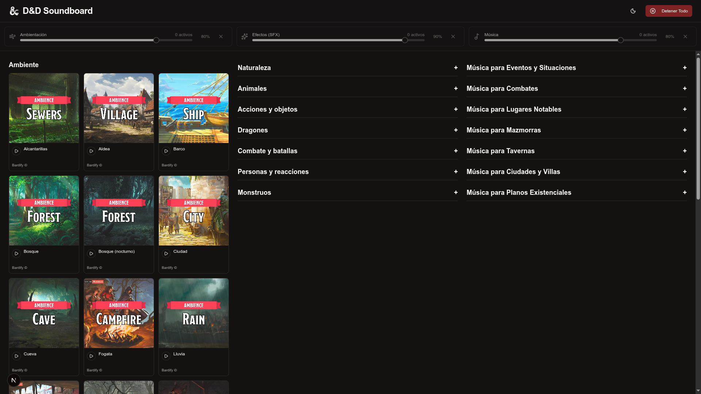

# D&D Soundboard

Suelo jugar Calabozos y Dragones con mis hijos, la ambientación auditiva la suelo hacer con Spotify y con YouTube, pero desde hace un tiempo los anuncios han hecho que deje de utilizar mi canal favorito, [Bardify](https://www.youtube.com/@bardify). Por este motivo he terminado construyendo una aplicación con [React](https://react.dev/) y [Next.js](https://nextjs.org) solo por diversión con apoyo de inteligencia artificial, un tablero de sonidos para la ambientación de partidas de rol.



## Empezando

Requisitos: Node.js 20.9 o superior y [pnpm](https://pnpm.io/). Este proyecto ya no usa npm ni `package-lock.json`.

Instalar dependencias:

```bash
pnpm install
```

Los scripts de instalación de las dependencias están bloqueados por defecto (ver `pnpm-workspace.yaml`). Solo `sharp`, el optimizador de imágenes de Next.js, está aprobado con `allowBuilds`. Si en el futuro agregas una dependencia que necesite compilar algo, pnpm fallará con `ERR_PNPM_IGNORED_BUILDS` y habrá que revisarla y aprobarla con:

```bash
pnpm approve-builds
```

También se aplica `minimumReleaseAge: 1440`: pnpm no instala versiones publicadas hace menos de 24 horas, que es justo la ventana en la que suelen detectarse los paquetes comprometidos. Por eso a veces se instala la versión inmediatamente anterior a la última; `pnpm update` la toma en cuanto cumple la edad mínima.

Luego, solo hay que lanzar el servidor:

```bash
pnpm dev
```

Abrir [http://localhost:3000](http://localhost:3000) con el navegador, y tendremos nuestro tablero corriendo.

Otros comandos:

```bash
pnpm build      # build de producción (Turbopack)
pnpm lint       # ESLint 10 con flat config
pnpm typecheck  # tsc --noEmit
```


## Añadiendo Audios

Para evitar algún tema legal, este proyecto se distribuye sin archivos de audio. Los archivos de audio se añaden en el directorio: `public/audio`. Yo los mantengo con una estructura de prefijos antes del título: `ambience-autor-titulo`, `music-autor-titulo`, `sfx-autor-titulo`.

La aplicación originalmente admitía archivos de audio en formato `opus`, `mp3` y `wav`. Sin embargo al crecer la libería de audio (+7 GB), elimine el soporte de `mp3` y `wav` para evitar parsear archivos inexistentes ya que `opus` mantiene un mejor balance entre calidad y tamaño de archivo.

Para convertir archivos de otros formatos a `opus`, se puede emplear `ffmpeg`:

```bash
ffmpeg -i input.mp3 -c:a libopus -b:a 128k output.opus
```

Si se descargan los archivos desde Youtube, se puede emplear `yt-dlp` para descargarlos así:

```bash
yt-dlp -x https://www.youtube.com/watch?v=F8bYaMoQ2sM -o ambience-bardify-forest.opus
```

La lista de audios que se muestran en el tablero se edita en `src/lib/audioFiles.ts`. Están ordenados en una especie de `array` organizado por secciones. El tablero se actualiza automáticamente al guardar los cambios, pero considerar añadir primero el audio al directorio de audios antes de añadirlo a `audioFiles.ts` para que se muestre inmediatamente y se pueda reproducir.

```TSX
  seccionespecifica: [
    { 
      name: "Audio de ejemplo", 
      url: "/audio/audio-example", 
      isLooping: true,
      license: "Autor"
    },
  ],
```

## Funcionamiento

El funcionamiento es simple. Solo hay que tocar el botón de _play_ y el sonido se reproducirá. Pueden sonar varias pistas de audio a la vez, las cuales son resaltadas visualmente y cada una tiene su control de volumen individual. Los efectos de sonido se pueden configurar para reproducirse en _loop_ o una sola vez.

Cuando algo se está reproduciendo aparece una barra inferior de mezcla con los tres canales del tablero: **Ambientación**, **Música** y **Efectos (SFX)**. Cada canal tiene su propio control de volumen, así que se puede bajar la ambientación poco a poco mientras la música y los efectos siguen sonando. El volumen de cada pista se multiplica por el volumen de su canal, y el botón de la _x_ detiene ese canal completo.

Todos los audios entran con un _fade-in_ y salen con un _fade-out_: al detener una pista, al detener un canal, al usar «Detener Todo» y también al final natural de los efectos de sonido. Los _fades_ se programan sobre el reloj de Web Audio, de modo que mantienen su duración aunque la pestaña quede en segundo plano.

## Créditos

D&D Soundboard es contenido de fans no oficial permitido por la Política de contenido de fans. No está aprobado ni respaldado por Wizards of the Coast.