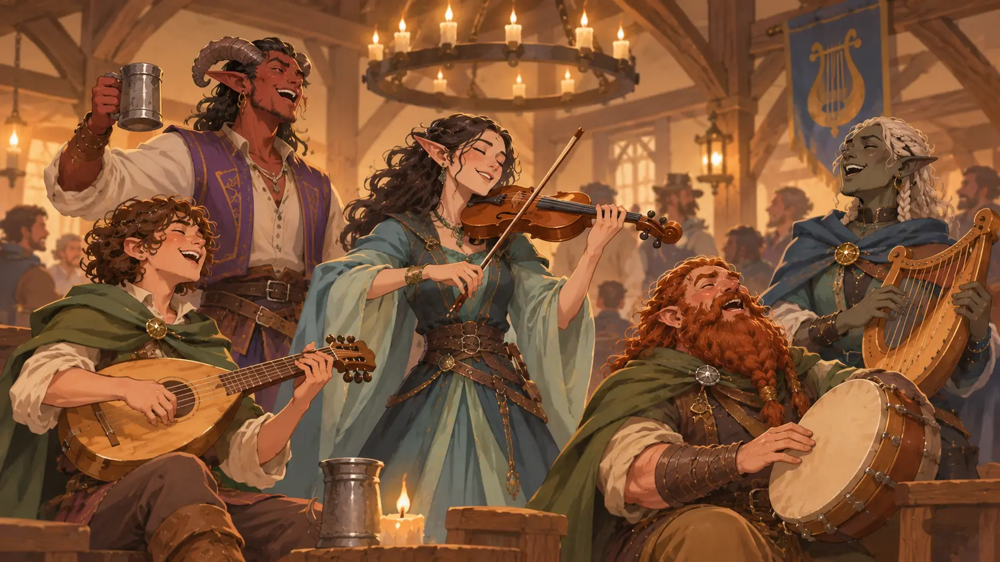

# D&D Soundboard



Suelo jugar Calabozos y Dragones con mis hijos y la ambientación de la mesa la hacía con Spotify y YouTube, hasta que los anuncios me hicieron dejar de usar mi canal favorito, [Bardify](https://www.youtube.com/@bardify) porque rompían el ritmo de la sesión. Así que terminé armando este tablero de sonidos para mis partidas con audio para ambientación, efectos para los golpes y música para cada escena, todo en una sola pantalla.


## En tres pasos

1. Copia tus audios a la carpeta `public/audio`.
2. Copia el catálogo de ejemplo y escribe ahí tus pistas: `cp public/tracks.example.yml public/tracks.yml` (si ya tenías un `tracks.yml`, guárdalo antes: ese comando lo reemplaza).
3. Ejecuta `pnpm install` la primera vez y después `pnpm dev`; abre [http://localhost:3000](http://localhost:3000).

Después de eso, para cambiar la lista solo editas `public/tracks.yml` y recargas la página. No hay que recompilar nada.

## Lo que necesitas

Node.js 20.9 o superior y [pnpm](https://pnpm.io/). Si vienes de npm, tranquilo: este proyecto usa pnpm y trae su propio `pnpm-lock.yaml`.

```bash
pnpm install     # la primera vez
pnpm dev         # levanta el tablero en http://localhost:3000
```

Cuando lo quieras dejar listo para usarlo sin la terminal de desarrollo:

```bash
pnpm build
pnpm start
```

## Poner tus audios

Este proyecto se distribuye sin archivos de audio, así que cada quien arma su biblioteca. Los sonidos van en `public/audio`.

La app reproduce `.opus`, que equilibra bien calidad y peso. Como mi biblioteca pasó los 7 GB, `mp3` y `wav` se quedaron fuera para no andar cargando archivos que no existen. Si tienes archivos en otro formato, conviértelos con `ffmpeg`:

```bash
ffmpeg -i mi-audio.mp3 -c:a libopus -b:a 128k mi-audio.opus
```

Y si los bajas de YouTube, `yt-dlp` te lo deja listo:

```bash
yt-dlp -x https://www.youtube.com/watch?v=F8bYaMoQ2sM -o ambience-bardify-forest.opus
```

El nombre del archivo lo eliges tú. Yo uso la costumbre `prefijo-autor-titulo` (`ambience-…`, `music-…`, `sfx-…`) para encontrarlos rápido en la carpeta, pero no cambia nada: la sección donde aparece cada pista la decide el catálogo, no el nombre.

### Las portadas son opcionales

Las tarjetas de ambiente buscan una imagen con el mismo nombre que el audio y extensión `.webp`. Para `public/audio/ambience-bardify-forest.opus` busca `public/audio/ambience-bardify-forest.webp`. Si no la encuentra, la tarjeta muestra un degradado con el ícono de la categoría. No hace falta complicarse.

## Armar tu lista

Todo el tablero sale de un solo archivo de texto: `public/tracks.yml`. El repositorio trae un ejemplo comentado en `public/tracks.example.yml`; para empezar de cero, cópialo como `public/tracks.yml` y edítalo:

```bash
cp public/tracks.example.yml public/tracks.yml
```

Así se ve lo mínimo:

```yaml
defaults:
  license: "Bardify ©"
  loop: true

ambient:
  tracks:
    - name: "Bosque de noche"
      file: "ambience-bardify-forest-night"

sfx:
  loop: false
  groups:
    - title: "Clima"
      tracks:
        - name: "Truenos"
          file: "sfx-truenos"

music:
  groups:
    - title: "Para el camino"
      tracks:
        - name: "Marcha"
          file: "music-marcha"
```

Cuatro cosas y ya sabes manejarlo:

- **Las tres secciones** son las tres columnas del tablero: `ambient` se ve como tarjetas, y `sfx` y `music` como grupos que se abren y se cierran (`groups`, cada uno con su `title` y sus `tracks`).
- **Cada pista** lleva `name` (lo que se ve en pantalla) y `file` (el archivo dentro de `public/audio`, sin extensión). Opcionalmente `license` (el crédito que aparece al tocar el botón de información) y `loop` (`true` para bucle, `false` para que suene una sola vez).
- **El orden del archivo es el orden del tablero.** Nada se ordena solo: si quieres mover una pista, mueves sus líneas.
- **`license` y `loop` se heredan.** Se escriben una vez en `defaults` y valen para todo; si una sección o un grupo necesita otra cosa, lo pisa; y una pista puntual puede pisar a los dos. Por eso el archivo queda corto.

Editas el archivo, recargas la página y aparecen los cambios. Si te equivocaste en algo (una clave mal escrita, una pista sin nombre o sin licencia, un audio repetido), el tablero te lo dice en pantalla con la ruta exacta del problema, en lugar de quedarse en blanco.

## Cómo se usa el tablero

Tocas un sonido y suena. Puedes tener varias pistas sonando a la vez: la ambientación de fondo, la música de la escena y los efectos puntuales.

- **Ambiente**: tarjetas con portada. Se toca la tarjeta entera para reproducir o pausar, y el volumen se maneja desde el canal de Ambientación.
- **Efectos y Música**: cada pista tiene su botón de play, su control de volumen y el botón de información con el crédito. Si la pista no está en bucle, aparece además un botón para repetirla.
- **La franja de canales** queda fija arriba, debajo del título, con **Ambientación**, **Efectos (SFX)** y **Música**. Cada canal tiene su volumen y su botón de _x_ para detenerlo completo. El volumen de cada pista se multiplica por el de su canal, así que puedes bajar la ambientación mientras la música y los efectos siguen sonando.
- **Detener Todo** está arriba a la derecha y corta absolutamente todo.

Todos los audios entran y salen suavecito. Cuando paras una pista, un canal o todo, el sonido se desvanece en lugar de cortarse de golpe, y los efectos de una sola vez también se desvanecen al terminar.

## Si algo no suena

- Revisa que el archivo esté realmente en `public/audio` y que el `file` del catálogo coincida con su nombre, sin la extensión.
- Si el tablero muestra un aviso con una ruta (por ejemplo `sfx.groups[0].tracks[2].file`), ahí está el problema: esa línea del catálogo tiene algo mal escrito.
- Si te falta el catálogo, el tablero te lo dice; copia `public/tracks.example.yml` a `public/tracks.yml` y vuelve a empezar.
- La portada que falta no rompe nada: la tarjeta se ve con un degradado.

## Créditos

D&D Soundboard es contenido de fans no oficial permitido por la Política de contenido de fans. No está aprobado ni respaldado por Wizards of the Coast.

La mayor parte de la música y la ambientación que uso es de [Bardify](https://www.youtube.com/@bardify). Los efectos los fui juntando con el tiempo y de algunos ya no recuerdo la procedencia; cada pista lleva su crédito en el catálogo, que es lo que aparece al tocar el botón de información.

## Para quien quiera meter mano

El proyecto es React + Next.js. Además de `pnpm dev`, hay `pnpm build` y `pnpm start` para producción, `pnpm lint` y `pnpm typecheck` para revisar el código, y `pnpm approve-builds` si alguna dependencia nueva necesita compilar algo (los scripts de instalación vienen bloqueados a propósito, ver `pnpm-workspace.yaml`).
